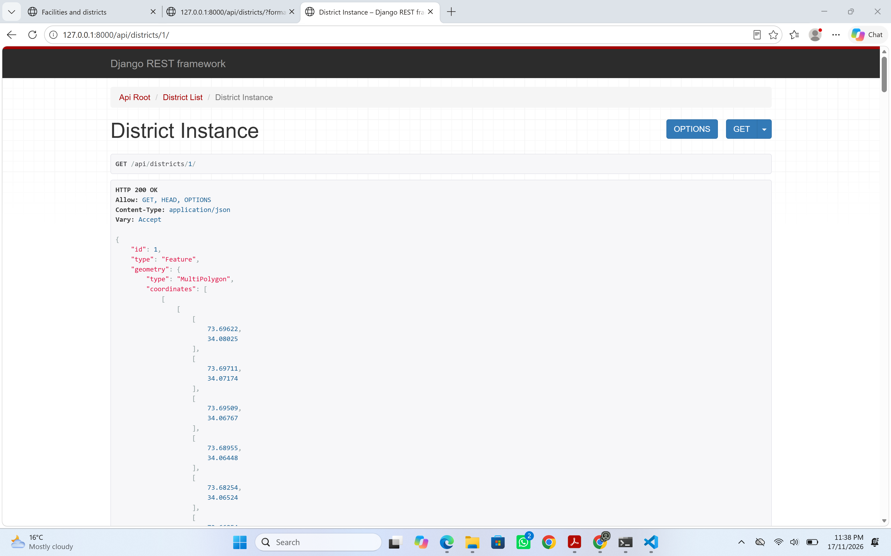
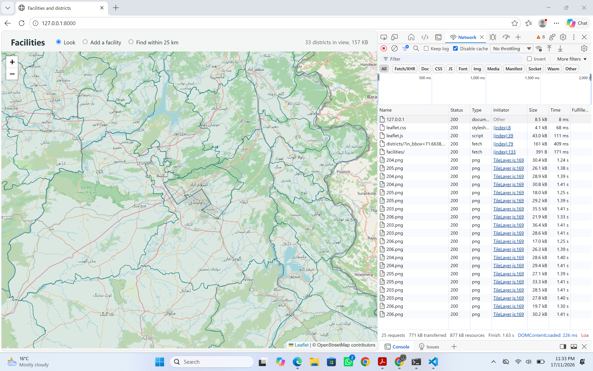
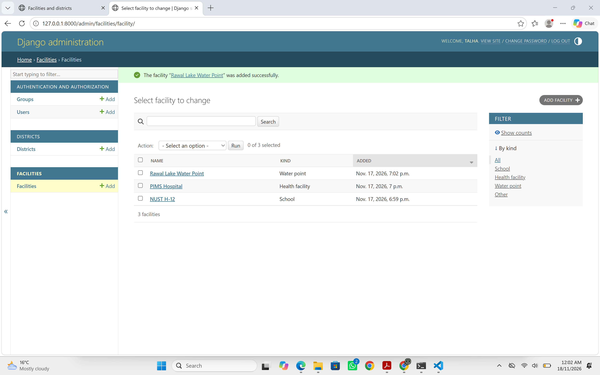
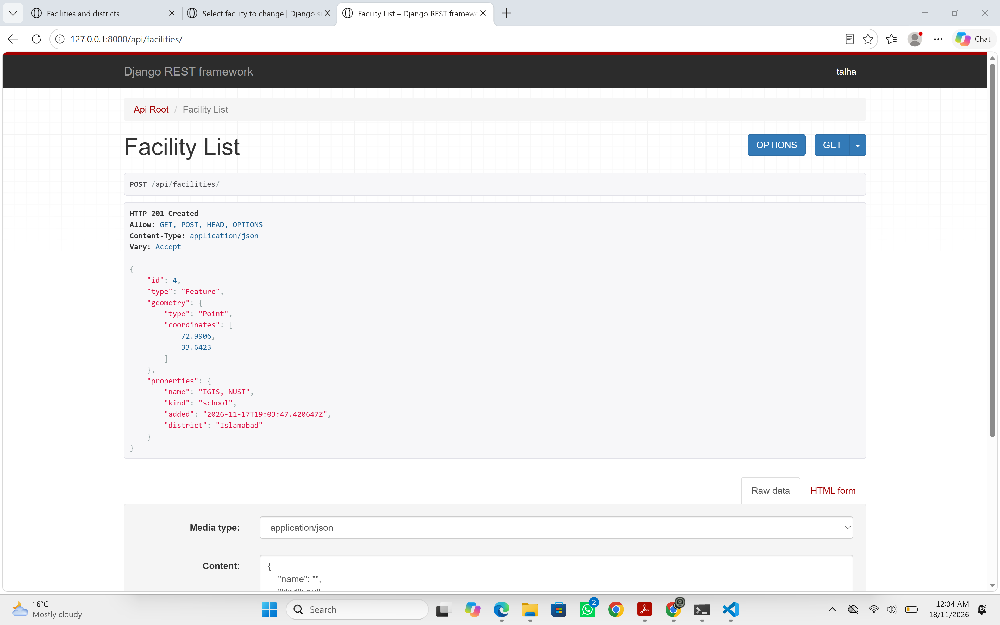
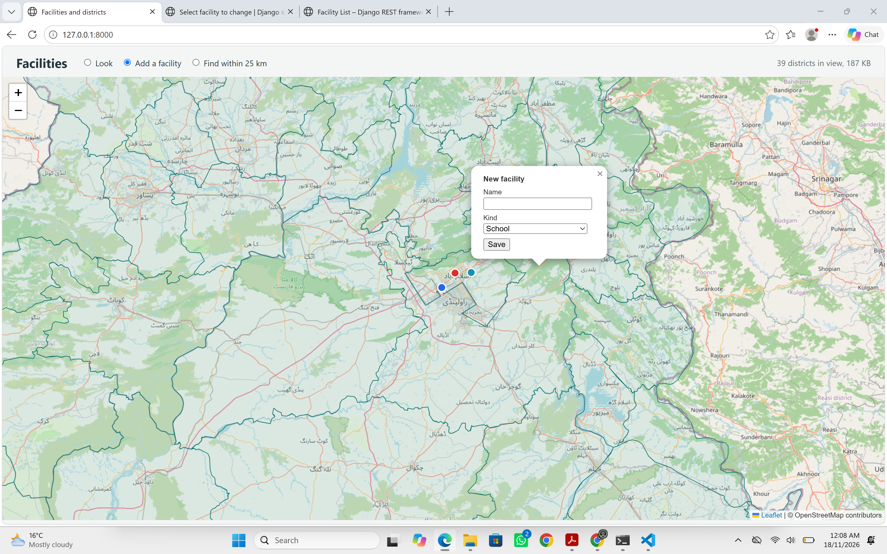
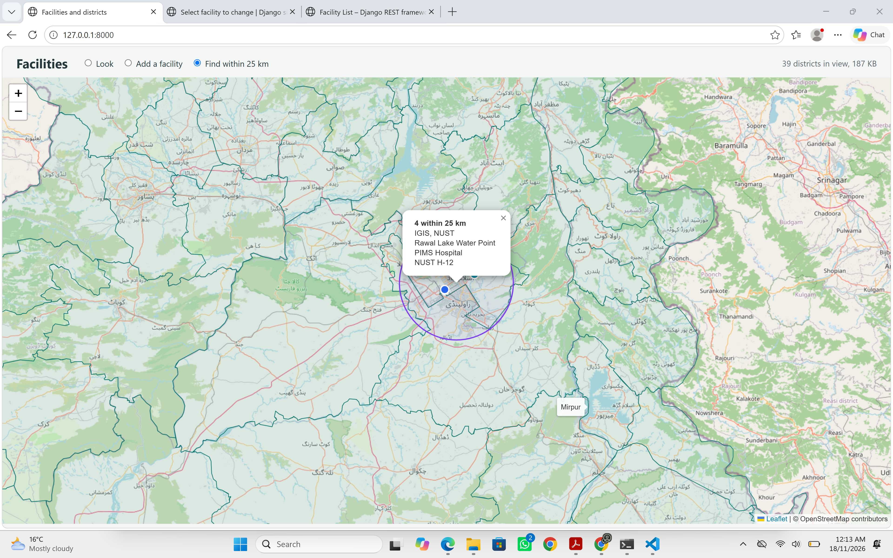

# Web GIS Lab 5 — A spatial API with GeoDjango

**Name:** Muhammad Talha Abdullah Khan
**Roll number:** 537711
**Course:** Web GIS, MS Remote Sensing and GIS, IGIS, NUST
**Repository:** https://github.com/Talhakhan366/webgis-lab5-537711

---

## Checkpoint 1: Setup

### pip freeze
```
asgiref==3.13.0
Django==6.1.2
django-filter==26.2
djangorestframework==3.18.3
djangorestframework-gis==1.3.0
psycopg==3.3.6
psycopg-binary==3.3.6
sqlparse==0.6.0
tzdata==2026.5
```

Versions used: Python 3.14.9, Django 6.1.2, djangorestframework 3.18.3, djangorestframework-gis 1.3.0, django-filter 26.2.
djangorestframework-gis 1.3 does not yet list Django 6.1 or Python 3.14 as tested, but everything in this lab ran with these versions.

### District count
```
> python manage.py shell -c "print(District.objects.count())"
16 objects imported automatically (use -v 2 for details).

160
```

### District count
```
> python manage.py shell -c "print(District.objects.count())"
160
```

## Checkpoint 2: First API



Size of `/api/districts/?format=json` in the Network tab: ____ KB (MB)

## Checkpoint 3: Loading by view

| View | Districts | Size |
|---|---|---|
| `/api/districts/?format=json`, everything | 160 | ____ |
| The map as it opens, Islamabad at zoom 9 | ____ | ____ |
| Zoomed out to zoom 6 | ____ | ____ |
| Zoomed in on Lahore at zoom 11 | ____ | ____ |



## Checkpoint 4: Facility model

CREATE TABLE "facilities_facility" (... "geom" geometry(POINT,4326) NOT NULL);
CREATE INDEX "facilities_facility_geom_ba199118_id" ON "facilities_facility" USING GIST ("geom");

Compared with the district table from Lab 4: both columns are PostGIS `geometry` in SRID 4326 with a GiST spatial index; the district column is `MULTIPOLYGON`, the facility column is `POINT`.



## Checkpoint 5: API validation



| Test | Error message returned |
|---|---|
| 1. Arabian Sea `[64.0, 23.0]` | (e.g. `"geometry": ["This point is not inside any district of Pakistan."]`) |
| 2. `"kind": "castle"` | (e.g. `"kind": ["\"castle\" is not a valid choice."]`) |
| 3. Swapped coordinates `[33.6423, 72.9906]` | (e.g. `"geometry": ["This point is not inside any district of Pakistan."]`) |

## Checkpoint 6: Collecting data from the map



Notes from Part 6.4:

1. **Facility in the Arabian Sea:** the form stayed open and showed the API's message "This point is not inside any district of Pakistan." Nothing was saved.
2. **Name ` Test`:** saved, and in Look mode the popup showed the name as plain text, with the tags visible. No alert appeared.
3. **`escapeHtml(p.name)` changed to `p.name`:** on reload, opening the popup made the browser create a broken image, its `onerror` ran and an alert box appeared. The code put back afterwards.
4. **CSRF:** after logging in to the admin in another tab, adding with the `X-CSRFToken` header worked. With the header deleted, saving failed with "CSRF Failed: CSRF token missing." The header was then put back.

## Checkpoint 7: Within 25 km (extension)



Every facility inside the purple circle was listed and none outside it.

---

## Questions

**1. Why does loading by view save so much at zoom 9 and so little at zoom 6? What would help at the scale of the whole country?**

At zoom 9 around Islamabad the view covers only a small area, so the bounding box touches a handful of districts and the response is a small part of the full file. At zoom 6 the view covers nearly all of Pakistan, so the box touches almost every district and the request is close to the full download. The bbox filter only reduces the number of features, not how detailed each one is. At country scale the fix is to send less detail per feature: simplify the geometries for small scales (for example with `ST_Simplify` or a pre-simplified copy of the table, chosen by zoom level), or serve vector tiles so each zoom level gets geometry at the detail it can show.

**2. The facility's district is worked out each time it is sent instead of being stored. Give one advantage and one cost.**

Advantage: it can never go out of date. If a district boundary is corrected or redrawn, every facility reports the right district straight away, with no stored value to update. Cost: it runs one point-in-polygon query per facility on every request, so a list of N facilities means N extra database queries. That gets slower as the data grows, where a stored column would just be read.

**3. The map already stops you clicking in the sea, so why must the server check the point as well?**

The map is only one way of reaching the API. Anyone can send a POST straight to `/api/facilities/` with the browsable API, curl, a script, or by editing the page's JavaScript in the browser, so checks in the browser can be bypassed. The server is the only place every request has to pass through, so the rule has to be enforced there. In this lab the server check also caught swapped `[lat, lng]` coordinates, which the map would never produce.

**4. Why did posting fail only after you logged in to the admin?**

Django REST Framework's `SessionAuthentication` enforces CSRF only for requests that are authenticated by a session cookie. Anonymous requests have no session to abuse, so the check is skipped. After logging in to the admin, the browser sent the session cookie with every request to the site, DRF treated the POST as coming from a logged-in user, and required the CSRF token. Without the `X-CSRFToken` header it refused the request.

**5. What happened in step 3 of Part 6.4, and who would it affect on a real site?**

Without `escapeHtml`, the saved name was inserted into the popup as HTML. The browser created the `` element, the image failed to load, and its `onerror` JavaScript ran and showed an alert. This is stored cross-site scripting. On a real site it would affect every visitor who opened that facility's popup, including logged-in staff and administrators. Instead of an alert, the script could steal session data, make requests in the victim's name (add or delete data), or redirect them to a fake page.

**6. What must exist before this API can safely allow DELETE?**

Authentication and permissions. Users need to log in (Lab 6), and the API needs permission rules that decide who may delete, for example only the user who created a facility or staff/admin users. That means adding a `created_by` owner field to the model, a DRF permission class (such as `IsAuthenticatedOrReadOnly` plus an owner-or-staff check), and keeping CSRF protection for session logins. Ideally deletions are also logged or soft-deleted so mistakes can be undone.